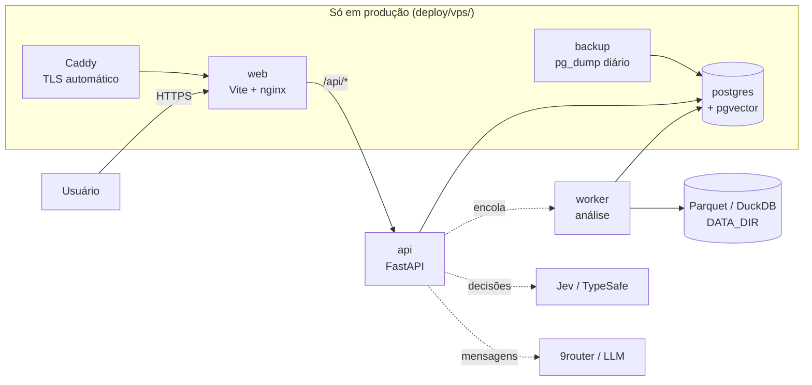

# predicts

**Preveja quando cada cliente vai voltar a comprar cada produto — a partir de um CSV.**

> 🚧 Em construção, em público.

Stack: Python (FastAPI, DuckDB, PostgreSQL + pgvector) · React (Vite, Tailwind, React Three
Fiber) · Docker Compose. Interface em pt-BR, español e English. Construído com um time de
agentes de IA orquestrado pelo [orch](https://github.com/hectorcanaimero/orch).

Leia esta seção (pt-BR, principal) ou vá direto para [Español](#español) / [English](#english).

## O que é

Você sobe um CSV de vendas, mapeia as colunas (cliente, data, SKU/EAN, produto) e o predicts
calcula o ciclo de recompra de cada cliente e produto, sugere lembretes e ofertas no momento
certo, mede a própria precisão com backtest nos seus dados e exporta tudo em CSV para o seu CRM.

- Estatística/ML decide **quando** (medido com backtest, nunca inventado).
- [Jev](https://typesafe.ai) toma as **decisões** com confiança (mapeamento de colunas, recompra
  ou durável, contatar ou não).
- Um LLM escreve as mensagens e explica os resultados — nunca decide números ou datas.

## Capturas

Ainda não há capturas de tela publicadas neste README — o painel (`web/`) e as cenas 3D
(`web/src/tres/`) ainda estão em construção nas fases F6–F8. Vão aparecer aqui a partir dos
scripts de captura automática (por exemplo `web/scripts/captura-procesamiento.ts`) conforme cada
tela fica pronta; ver `build-in-public/diario/` (fora do git) para o andamento.

## Demo

Botão "experimentar com dados de exemplo" (`POST /demo`, `api/src/predicts/api/demo.py`): cria
um projeto "Demo" com uma amostra do **Online Retail II** (ver [Licenças](#licenças-dos-datasets)
abaixo) e já deixa a análise completa na fila, sem precisar subir nada. Disponível na lista de
projetos vazia e na rota `web/src/routes/_autenticado/demo.tsx` depois de logar.

## Como rodar localmente

Requer Docker e Docker Compose.

```bash
git clone https://github.com/hectorcanaimero/predicts.git
cd predicts/deploy
cp .env.example .env   # completar ROUTER_*/TYPESAFE_* só se quiser IA real; o resto funciona com os defaults
docker compose config  # valida o arquivo sem alterar nada
docker compose up -d --build
```

- Painel: <http://localhost:8080> (porta `WEB_PORT`, default `8080`).
- API: <http://localhost:8000> (porta `API_PORT`, default `8000`), proxeada em `/api/` pelo
  painel.
- Checagem de saúde: `curl http://localhost:8080/api/salud`.

Detalhes (logs, Postgres de desenvolvimento, limites de memória por serviço):
`docs/notas/desarrollo.md`. Para subir em um VPS próprio com HTTPS automático (Caddy), backup
diário do Postgres e firewall: `docs/notas/despliegue.md` e `deploy/vps/`.

## Arquitetura



Cada caixa é um serviço do `docker compose` (`deploy/docker-compose.yml`, mais
`deploy/vps/docker-compose.prod.yml` em produção). Detalhe completo dos contratos e do esquema de
dados: `docs/arch/001-predicts.md`.

## Licenças dos datasets

Nenhum dado de cliente real está neste repositório. Os datasets públicos usados em
desenvolvimento, testes e na demo (`docs/notas/datasets.md`):

- **Online Retail II** (UCI Machine Learning Repository) — licença **CC BY 4.0**. Citação: Chen,
  D. (2012). *Online Retail II* [Dataset]. UCI Machine Learning Repository.
  <https://doi.org/10.24432/C5CG6D>. É o dataset que alimenta o botão de demo (`POST /demo`), com
  a atribuição visível na interface.
- **Instacart Market Basket Analysis** (competição do Kaggle, 2017) — licença específica da
  competição, sem texto de licença mais preciso publicado pelo Kaggle; requer login para baixar.
  Usado só localmente por quem já tem os CSV (`predicts preparar-dataset instacart --desde
  <pasta>`), nunca baixado automaticamente nem commitado.

O código deste repositório é **MIT** (`LICENSE`).

---

## Español

### Qué es

Subís un CSV de ventas, mapeás las columnas (cliente, fecha, SKU/EAN, producto) y predicts
calcula el ciclo de recompra de cada cliente y producto, sugiere recordatorios y ofertas en el
momento justo, mide su propia precisión con backtest sobre tus datos y exporta todo en CSV para
tu CRM.

- Estadística/ML decide **cuándo** (medido con backtest, nunca inventado).
- [Jev](https://typesafe.ai) toma las **decisiones** con confianza (mapeo de columnas, recompra o
  durable, contactar o no).
- Un LLM escribe los mensajes y explica los resultados — nunca decide números ni fechas.

### Capturas

Todavía no hay capturas publicadas en este README — el panel (`web/`) y las escenas 3D
(`web/src/tres/`) están en construcción en las fases F6–F8. Van a aparecer acá desde los scripts
de captura automática (por ejemplo `web/scripts/captura-procesamiento.ts`).

### Demo

Botón "probar con datos de ejemplo" (`POST /demo`): crea un proyecto "Demo" con una muestra de
**Online Retail II** (ver [Licencias](#licencias-de-los-datasets) abajo) y encola el análisis
completo, sin subir nada. Disponible en la lista de proyectos vacía y en
`web/src/routes/_autenticado/demo.tsx`.

### Cómo correrlo local

Requiere Docker y Docker Compose.

```bash
git clone https://github.com/hectorcanaimero/predicts.git
cd predicts/deploy
cp .env.example .env
docker compose up -d --build
```

Panel en <http://localhost:8080>, API en <http://localhost:8000> (proxeada en `/api/` por el
panel), `curl http://localhost:8080/api/salud` para verificar. Detalle en
`docs/notas/desarrollo.md`; despliegue en un VPS propio con TLS automático en
`docs/notas/despliegue.md` y `deploy/vps/`.

### Arquitectura

Ver el diagrama en la [sección pt-BR](#arquitetura) arriba — es el mismo stack, `web` → `api` →
`postgres`/`worker`, con Caddy y el backup diario sumándose solo en producción
(`deploy/vps/docker-compose.prod.yml`).

### Licencias de los datasets

Ningún dato de cliente real está en este repositorio. Ver el detalle completo en
[la sección pt-BR](#licenças-dos-datasets): **Online Retail II** (CC BY 4.0, usado en la demo) e
**Instacart Market Basket Analysis** (licencia de la competencia de Kaggle, solo local, nunca
commiteado). El código de este repositorio es **MIT** (`LICENSE`).

---

## English

### What it is

You upload a sales CSV, map the columns (customer, date, SKU/EAN, product), and predicts
calculates each customer/product repurchase cycle, suggests reminders and offers at the right
time, measures its own accuracy with a backtest on your own data, and exports everything to CSV
for your CRM.

- Statistics/ML decides **when** (measured with a backtest, never invented).
- [Jev](https://typesafe.ai) makes the **decisions** with confidence (column mapping, repurchase
  vs. durable, whether to contact a customer).
- An LLM writes the messages and explains the results — it never decides numbers or dates.

### Screenshots

No screenshots are published in this README yet — the panel (`web/`) and the 3D scenes
(`web/src/tres/`) are still under construction in phases F6–F8. They'll land here from the
automatic capture scripts (e.g. `web/scripts/captura-procesamiento.ts`) as each screen ships.

### Demo

"Try it with sample data" button (`POST /demo`): creates a "Demo" project with a sample of
**Online Retail II** (see [Licenses](#dataset-licenses) below) and queues the full analysis, no
upload needed. Available on the empty projects list and at
`web/src/routes/_autenticado/demo.tsx`.

### Running it locally

Requires Docker and Docker Compose.

```bash
git clone https://github.com/hectorcanaimero/predicts.git
cd predicts/deploy
cp .env.example .env
docker compose up -d --build
```

Panel at <http://localhost:8080>, API at <http://localhost:8000> (proxied under `/api/` by the
panel), `curl http://localhost:8080/api/salud` to check. Details in `docs/notas/desarrollo.md`;
deploying to your own VPS with automatic TLS in `docs/notas/despliegue.md` and `deploy/vps/`.

### Architecture

See the diagram in the [pt-BR section](#arquitetura) above — same stack, `web` → `api` →
`postgres`/`worker`, with Caddy and the daily backup only added in production
(`deploy/vps/docker-compose.prod.yml`).

### Dataset licenses

No real customer data lives in this repository. Full detail in the
[pt-BR section](#licenças-dos-datasets): **Online Retail II** (CC BY 4.0, powers the demo) and
**Instacart Market Basket Analysis** (Kaggle competition license, local-only, never committed).
This repository's code is **MIT** (`LICENSE`).

## Licença / Licencia / License

MIT
