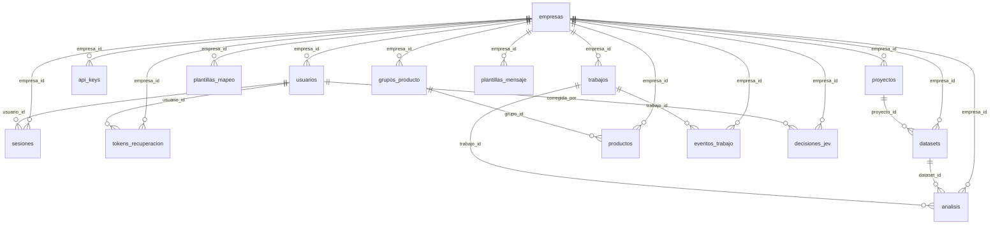

# Esquema de Postgres

Fuente de verdad: `api/src/predicts/db/modelos.py` (modelos ORM) + `api/alembic/versions/0001_esquema_inicial.py`
(única migración, ver docs/arch/001-predicts.md#modelo-de-datos). `alembic check` falla el
build si alguien edita un modelo sin generar/ajustar la migración.

## Diagrama

`intentos_login` no tiene FK (se registran intentos aunque el email no exista, para
limitar fuerza bruta) y no aparece en el diagrama.

## Reglas generales

- Toda tabla de negocio lleva `id` (UUID v7, ordenable por tiempo — mejor localidad de
  índice que v4 en la PK), `empresa_id` (FK a `empresas`, `ON DELETE CASCADE`) y los
  timestamps `creado_en`/`actualizado_en`. Excepciones explícitas: `empresas` (es el propio
  tenant, sin `empresa_id`) e `intentos_login` (log de seguridad sin `empresa_id`, inmutable,
  sin `actualizado_en`).
- Las columnas con un conjunto fijo de valores (`idioma`, `rol`, `estado`, `tipo`, `tono`,
  …) son `VARCHAR` con un `CHECK` nombrado (`ck_<tabla>_<columna>`) en vez de un `ENUM` de
  Postgres, para no pagar un `ALTER TYPE` cada vez que la fase siguiente agregue un valor.
- Los campos JSON de la arquitectura son `JSONB`.

## Por qué cada índice

- `ix_<tabla>_empresa_id` (todas las tablas de negocio): toda consulta de la aplicación
  filtra por la empresa actual primero; sin este índice cada listado hace un scan completo.
- `uq_usuarios_email` + `ck_usuarios_email_minusculas`: el login busca por email exacto y
  la arquitectura exige que se guarde en minúsculas; el `CHECK` hace la invariante imposible
  de romper desde fuera de la app.
- `uq_sesiones_token_hash`, `uq_tokens_recuperacion_token_hash`, `uq_api_keys_key_hash`:
  son las columnas por las que se autentica cada request; tienen que ser únicas y el
  lookup tiene que ser por índice, no por scan.
- `ix_api_keys_prefijo`: el prefijo (no secreto) identifica la clave antes de verificar el
  hash completo, para dar mensajes de error sin exponer ni comparar el secreto.
- `ix_intentos_login_email_creado_en`, `ix_intentos_login_ip_creado_en`: el limitador de
  fuerza bruta cuenta intentos recientes por email y por IP; sin el índice compuesto cada
  intento de login escanea toda la tabla.
- `uq_plantillas_mapeo_empresa_id_firma_encabezados`: una firma de encabezados (hash de las
  columnas del CSV) solo puede mapear a una plantilla por empresa; también sirve de índice
  para encontrar la plantilla al subir un CSV con la misma firma.
- `ix_datasets_proyecto_id`, `ix_datasets_sha256`: listar datasets de un proyecto y
  detectar que un archivo ya se subió (dedupe por hash) son las dos consultas de `datasets`.
- `uq_productos_empresa_id_nombre_normalizado`: evita duplicar el mismo producto dos veces
  dentro de una empresa (es la clave de negocio real, no solo una optimización).
- `ix_productos_embedding_hnsw` (HNSW, `vector_cosine_ops`): la agrupación de productos
  similares busca vecinos más cercanos por coseno; sin índice, pgvector haría un scan
  exacto contra todas las filas de la empresa en cada agrupación.
- `ix_productos_grupo_id`: listar los productos de un grupo propuesto/confirmado.
- `ix_trabajos_estado_creado_en`: el worker hace
  `SELECT … WHERE estado = 'en_cola' ORDER BY creado_en FOR UPDATE SKIP LOCKED`; el índice
  compuesto evita un scan de la cola completa en cada tick.
- `uq_eventos_trabajo_trabajo_id_secuencia` + `ix_eventos_trabajo_trabajo_id`: el stream SSE
  reanuda desde la última secuencia vista por trabajo; la unicidad evita eventos duplicados
  si el productor reintenta.
- `ix_decisiones_jev_tipo_referencia`: revisar las decisiones de Jev sobre un objeto
  concreto (por tipo + id referenciado) es la consulta de la pantalla de revisión.
- `uq_plantillas_mensaje_empresa_id_clave_idioma_tono`: la clave de negocio real de una
  plantilla de mensaje (qué texto usar para un producto/grupo, en qué idioma y tono) debe
  ser única por empresa; también permite el lookup directo al generar un mensaje.
